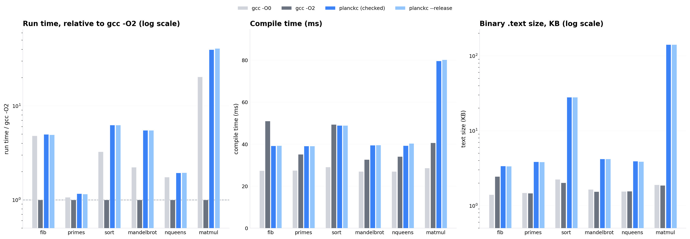

# Benchmarks

## Abstract

This report measures the Planck compiler and the code it generates, using the
harness in `benches/`. Three questions are answered: how fast does `planckc`
compile, how fast do Planck programs run compared to equivalent C compiled by
gcc, and what does the checked-arithmetic safety net cost. The headline
numbers on the reference machine: Planck compiles as fast as gcc (40-85 ms for
these programs), generated code runs at **5.0x gcc -O2** (geometric mean,
down from 5.9x before the stage-1 register allocator landed),
and the integer overflow checks cost **about 2% or less**. The dominant
remaining gap is structural, not accidental: the full Machine IR with
iterated register coalescing (the rest of ticket PLK-012), alias analysis
(PLK-011), and vectorization are the next levers.

## Methodology

Six compute-bound programs, each paired with a line-for-line C mirror
(`benches/*.plk`, `benches/c/*.c`). Every program prints a checksum; the
harness refuses results unless all four configurations print the identical
checksum, which cross-validates the whole stack (language semantics, codegen,
and the C mirrors) on every run.

| Benchmark | Exercises | Work per run |
|---|---|---|
| fib | deep recursion, checked i64 adds on the hot path | fib(35), 29,860,703 calls |
| primes | i64 remainder, nested loops, early returns | trial division below 200,000 |
| sort | loops, borrow passing, index bounds checks, memory traffic | 600 rounds of 512-element mergesort |
| mandelbrot | f64 arithmetic and compares, short-circuit loop condition | 400x300 lattice, 100-iteration cap |
| nqueens | i64 bitwise logic, multi-argument recursion | 11-queens, 10 rounds |
| matmul | reference dereference reads/writes, flat index arithmetic, checked i32 math | 150 rounds of 48x48 matmul |

Four configurations per program:

| Config | Meaning |
|---|---|
| `c_o0` | `gcc -O0` |
| `c_o2` | `gcc -O2` (the reference, 1.00x by definition) |
| `planck` | `planckc build` -- optimization pipeline ON, integer overflow checks ON |
| `planck_release` | `planckc build --release` -- checks OFF (wrapping per design Part 3) |

Compile time is the median of six full toolchain invocations (the first is
discarded as warmup); for Planck that includes `as` and the `cc` link step.
Run time is the median of seven executions. Text size comes from `size`.
Reference machine: Intel Xeon, Debian gcc 14.2.0, Linux 6.x. Raw numbers are
committed in `benches/results.json`; `benches/bench.py` and
`benches/make_charts.py` regenerate everything (`cargo build --release &&
python3 benches/bench.py && python3 benches/make_charts.py`).

Two sources are generated and committed (`benches/sort.plk`,
`benches/matmul.plk`, by `benches/gen_sources.py`): the language has no
repeat-array expression, so large zero-initialized arrays must be spelled
element by element (ticket PLK-030). Workloads are sized so the checked
configuration runs in roughly 15-220 ms.

## Results

### Run time (median of 7, lower is better)

| Benchmark | gcc -O0 | gcc -O2 | planck (checked) | planck --release | checked vs C -O2 |
|---|---|---|---|---|---|
| fib | 67.6 ms | 14.1 ms | 70.0 ms | 69.5 ms | 5.0x |
| primes | 11.7 ms | 11.0 ms | 12.8 ms | 12.7 ms | 1.2x |
| sort | 43.4 ms | 13.3 ms | 83.3 ms | 83.6 ms | 6.2x |
| mandelbrot | 11.0 ms | 4.9 ms | 27.2 ms | 27.2 ms | 5.5x |
| nqueens | 20.4 ms | 11.7 ms | 22.6 ms | 22.7 ms | 1.9x |
| matmul | 98.7 ms | 4.8 ms | 192.7 ms | 197.6 ms | 39.8x |
| **geometric mean** | **3.32x** | **1.00x** | **4.99x** | **5.00x** | |

### Compile time (median of 6, full toolchain)

| Benchmark | gcc -O0 | gcc -O2 | planckc | planckc --release |
|---|---|---|---|---|
| fib | 27.4 ms | 51.0 ms | 39.2 ms | 39.3 ms |
| primes | 27.5 ms | 35.2 ms | 39.1 ms | 39.1 ms |
| sort | 29.1 ms | 49.4 ms | 48.9 ms | 48.9 ms |
| mandelbrot | 27.0 ms | 32.7 ms | 39.5 ms | 39.6 ms |
| nqueens | 27.0 ms | 34.1 ms | 39.3 ms | 40.3 ms |
| matmul | 28.6 ms | 40.6 ms | 79.6 ms | 80.2 ms |

### Binary .text size

| Benchmark | gcc -O0 | gcc -O2 | planckc |
|---|---|---|---|
| fib | 1438 B | 2508 B | 3455 B |
| primes | 1517 B | 1502 B | 3939 B |
| sort | 2296 B | 2072 B | 28723 B |
| mandelbrot | 1682 B | 1574 B | 4309 B |
| nqueens | 1589 B | 1596 B | 4017 B |
| matmul | 1951 B | 1913 B | 144566 B |

## Analysis

**The overflow checks are free.** The checked configuration is within run-to-run
noise of `--release` everywhere (the largest deviation is 2.5% on matmul, and
fib measures 0.7% *faster* checked; the sign flips both ways). The trap
path is a compare-and-branch on each arithmetic node, perfectly predicted
not-taken in these workloads. This is a meaningful claim for the language's
safety story: design Part 3's checked-by-default arithmetic does not tax
correct programs on this evidence. (The one caveat: these kernels are
branch-dominated; check overhead on tight dependency chains could be larger.)

**What the stage-1 register allocator bought.** Ticket PLK-012's first stage
(`crates/planck_codegen/src/alloc.rs`) caches the hottest vregs in registers
the emitter never uses as scratch: callee-saved `rbx`/`r12`-`r15` for
integers, `xmm8`-`xmm12` for floats not live across calls. Liveness plus
natural-loop depth weight the selection; every other value keeps its frame
slot, so the spill path is the old emitter unchanged. Measured against the
same suite on the same machine, the geometric mean improved from 5.90x to
4.99x gcc -O2 (fib 1.12x, primes 1.12x, sort 1.16x, mandelbrot 1.38x,
nqueens 1.38x, matmul 1.14x faster than before), and every .text section
shrank -- register moves replaced load/store pairs. What is *not* won yet:
the SSA-destruction copies at loop joins still round-trip through memory
slots (coalescing, the rest of PLK-012), and array traffic still pays bounds
checks plus no alias analysis (PLK-011).

**Where Planck is already close.** primes (1.2x) and nqueens (1.9x) are
branchy and division/bit-heavy; there the residual frame traffic hurts least
because the hardware divide and the unpredictable branches dominate, and gcc
-O2 cannot remove the work either.

**Where the value model still dominates.** sort (6.2x) and matmul (39.8x)
are memory-heavy kernels: every array element access goes through explicit
bounds checks and address arithmetic, and without alias analysis (PLK-011)
the allocator cannot keep elements in registers across stores. gcc -O2 also
vectorizes matmul. These remain the expected shape of the gap: the
optimizer's ILP work is sound but the backend cannot fully express it until
the Machine IR stage of PLK-012 lands.

**Compile time is competitive.** 40 ms for small programs -- the same league
as gcc, with the full SSA pipeline and eleven optimization passes running,
plus a verifier gate after every pass. The matmul outlier (80 ms) is parsed
source volume: 24 KB of array-literal elements (ticket PLK-030 again).

**Code size tracks the same story.** Small programs are within 2x of C. The
matmul 145 KB is not the matmul kernel -- it is the three 2304-element array
literals lowered as one store per element, roughly 60 instructions per zero
written (ticket PLK-029 proposes bulk `rep stos`/memcpy lowering).

## Bugs the benchmark suite caught

The suite paid for itself immediately: writing realistic programs surfaced
four real miscompiles/compiler crashes that the pre-existing test suite had
missed, all now fixed with regression tests:

1. **Duplicate `Ldiv_ok` labels** (codegen): two division sites in one
   function both used the function index as label suffix -- the second `%`
   in a function produced an assembler error.
2. **Duplicate `Lflt` labels** (codegen): re-encountering an existing float
   constant re-inserted it into the pool with a fresh label, renaming the
   old entry and colliding with a later distinct constant.
3. **LICM miscompile of nested loops** (optimizer): LICM ran after SSA
   destruction and hoisted the inner loop's induction-variable initialization
   (a multi-def vreg after phi lowering) out of the outer loop, so nested
   `for` loops executed their inner loop only on the first outer iteration.
   A 3x4 nested loop printed 4 instead of 12. The fix pins multi-def vregs;
   regression tests cover the LICM unit and the end-to-end nested-loop
   behavior (`nested_for_loops_reinitialize_inner_induction`,
   `nested_loops_with_float_carry`).
4. **Shift lowering used a byte register with a 64-bit suffix** (codegen,
   found while validating the stage-1 register allocator): `shlq %al, ...`
   is rejected by the assembler -- the count/value register pair must match
   the instruction width (`shlq %rcx, %rax`). No existing test exercised a
   64-bit shift; `shifts_compute_at_all_widths` now covers every width end
   to end.

The lesson matches the design's correctness hierarchy: observable program
behavior (CEP-2) is the only test that attests the whole pipeline; the
verifier gates check invariants per pass but cannot catch a *legal-IR*
transformation that changes semantics.

## Language sharp edges recorded while writing the benchmarks

Encountered while fitting programs to the v0.1 subset; recorded as ticket
PLK-030 with the exact repros, since each needs a spec ruling rather than a
local fix:

* no repeat-array expression (`[0; N]`), and definite initialization is
  whole-value granular -- large arrays are impractical to declare;
* `if` is a statement, not an expression (`let x = if c { a } else { b }`
  does not parse);
* an integer literal as the *left* operand of a binary expression defaults
  to i32 and does not widen to the other operand's type, so
  `big_lit + x as i64` fails where `x as i64 + big_lit` compiles;
* reference parameters cannot be forwarded (`PLK-S0006` requires a fresh
  `&`/`&mut` at each call site) and methods cannot be called through
  references (`PLK-S0017`), which shapes how helper functions over arrays
  and structs must be written.

## Threats to validity

Single machine, one run family; medians damp but do not eliminate scheduler
noise, and the C -O2 numbers for primes/mandelbrot are small enough (5-11 ms)
that a few percent of the gap is measurement floor. The workloads are
integer/float kernels without heap allocation, matching the v0.1 language
surface -- they measure the compiler, not the runtime library. Absolute
numbers will drift with hardware; the relative structure (checked vs
release ~equal, register-allocation-bound kernels far off -O2) is the
durable finding. Re-run with `python3 benches/bench.py` before quoting
updated numbers.
